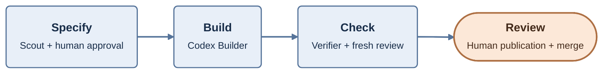

# Aegean

Aegean coordinates Claude Code and Codex to turn an approved specification into a verified software change.

The Builder cannot read the protected acceptance tests. A separate verifier checks the candidate against them.
You approve the scope, approve publication and decide whether to merge.

[Workflow](docs/WORKFLOW.md) · [Architecture](docs/ARCHITECTURE.md) · [Guides](docs/README.md) · [Contribute](CONTRIBUTING.md)


> **Experimental.** Specification drafts have reached human review in controlled trials.
> Full delivery still requires release acceptance or an authorised pilot. See [status and evidence](docs/STATUS.md).

## How it works



- **Approve one contract.** OpenSpec records the requirements, allowed paths and implementation plan.
- **Check independently.** The test author receives the contract without the implementation. The verifier checks the base commit before the candidate.
- **Keep evidence current.** A changed contract or candidate invalidates its earlier approval or verification.

The [architecture](docs/ARCHITECTURE.md) explains the components, isolation and design trade-offs.

## Start here

For an approved installation, follow the [installation guide](docs/OPERATIONS.md#install-on-either-mac).
Then [prepare the project and request](docs/OPERATIONS.md#prepare-the-project-and-the-request).

In the enrolled project, start the interactive guide:

```sh
aegean guide
```

The guide covers host checks, the request and specification review. See the [workflow](docs/WORKFLOW.md) for later stages.

| Read next | Purpose |
| --- | --- |
| [Architecture](docs/ARCHITECTURE.md) | Understand the design and its limits. |
| [Operations](docs/OPERATIONS.md) | Install, run, inspect and recover. |
| [Testing](docs/TESTING.md) | Run source checks and find the evidence for each control. |
| [Engineering reference](docs/ENGINEERING.md) | Find decisions, release gates and trial records. |

The first adapter supports command-line changes on macOS with subscription CLI accounts.
This repository is private and has no software licence.
