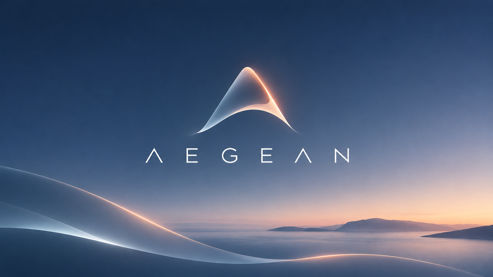

# Aegean

Aegean coordinates Claude Code and Codex to draft specifications, write code and
check software changes. It uses OpenSpec to record the requirements.

You approve the specification before implementation and the code before publication.
You decide whether to merge the pull request.

[Workflow](docs/WORKFLOW.md) · [Guides](docs/README.md) · [Contribute](CONTRIBUTING.md)

## How it works

1. **Specify.** The Scout drafts the requirements from your request and the
   committed project files. You review and approve the scope before code changes begin.
2. **Build.** The Builder writes code in an isolated worktree against the approved
   specification.
3. **Check.** A separate Auditor creates protected tests and reviews the code.
   The verifier runs the tests on the unchanged code first, then on the candidate,
   and records the results.
4. **Review.** You inspect the code diff and results, approve the push and decide
   whether to merge.

See the [workflow guide](docs/WORKFLOW.md) for the roles and review steps.

## Use Aegean

Aegean currently supports specification drafting and review in controlled trials.
Full delivery remains under evaluation and requires release acceptance or an authorised pilot.
Use the [installation and command guide](docs/OPERATIONS.md) for a fresh installation, host checks and a controlled pilot.
Aegean works in an existing GitHub repository; first [prepare the project and the request](docs/OPERATIONS.md#prepare-the-project-and-the-request).
In the project folder, run `aegean guide`. The [interactive guide](docs/OPERATIONS.md#use-the-interactive-guide) asks a question for each step, from the host check to the specification approval.
Use `./scripts/dev help` for local build commands; see [Contribute](CONTRIBUTING.md) for source checks.

The initial scope is command-line changes on macOS with subscription CLI accounts.
See [engineering details](docs/ENGINEERING.md) for architecture, decisions and evidence.

This repository remains private and has no software licence.
