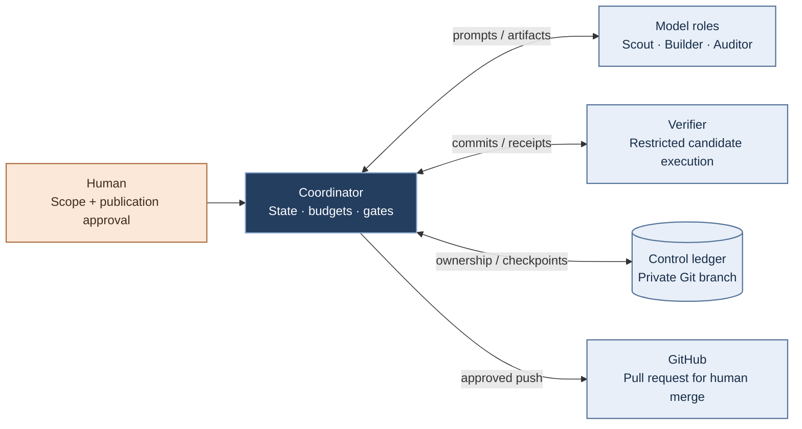
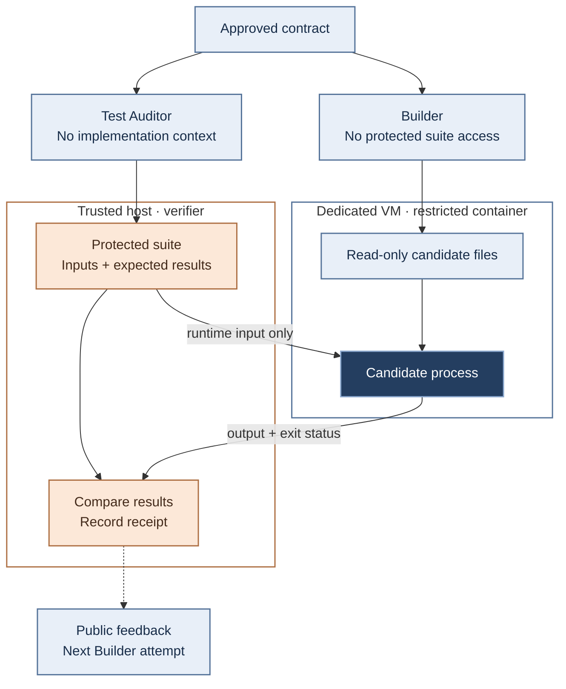

# Architecture

[Overview](../README.md) · [Workflow](WORKFLOW.md) · [Testing](TESTING.md) · [Status](STATUS.md)

Aegean separates the contract, implementation and evidence. A deterministic coordinator controls each transition and external action.
Models propose artifacts; code checks the gates; the human approves scope, publication and merge.

This page describes the source design. [Status](STATUS.md) records what trials established.

## System components



The coordinator passes selected artifacts between roles. There is no shared agent conversation or direct agent-to-agent channel.
The verifier uses no model.

## Roles

| Role | Receives | Produces |
| --- | --- | --- |
| Scout — Claude Code | Request, project checks and selected committed files. | Draft OpenSpec contract and review notes. |
| Test Auditor — Claude Code | Approved requirements and public requirement IDs. No implementation context. | Protected input/output cases. |
| Builder — Codex | Approved contract, candidate files, public checks and filtered repair feedback. | Candidate code. |
| Review Auditor — Claude Code | Contract, complete candidate diff and public verification feedback. | Findings with an owner. |
| Verifier | Exact commit, public checks and protected suite. | A receipt with test results and artifact identities. |
| Human | Specification, diff, results and findings. | Scope approval, publication approval and merge decision. |

The two Auditor tasks use separate, fresh calls. The reviewer sees the code deliberately; it does not receive the Builder's conversation.
Independent context reduces shared assumptions. It does not prove that a model's tests or findings are correct.

The [Scout module](../src/domain/scout.ts) and the [role prompts](../src/domain/prompts.ts) give the exact text of each role input.
[Context assembly](../src/domain/context.ts) frames and limits the files in that input. The [Claude adapter](../src/adapters/agents.ts) disables tools and saved sessions.

## Protected verification



The coordinator mediates these transfers. Solid arrows show artifacts and execution data. The dashed arrow shows filtered feedback for a later repair.

- **The suite stays outside the candidate.** No protected test files, expected results, credentials or Docker socket enter the container.
- **The candidate sees its runtime input.** The host compares output and exit status with private expectations; it never imports candidate code.
- **Repair feedback stays narrow.** The Builder receives public requirement IDs and text, scope breaches and Builder-owned review findings.
- **Raw results stay private.** Hidden cases, expected results, actual output and test Auditor text do not enter repair feedback.

The verifier rejects symlinks and paths that can contain secrets before export. Public checks use the same restricted container.

The [verifier adapter](../src/adapters/verifier.ts) owns execution and comparison.
The [feedback rules](../src/domain/feedback.ts) own the information returned for repair.

## Design choices

| Choice | Reason | Cost or limit |
| --- | --- | --- |
| Approved OpenSpec contract | Give implementation and tests the same explicit requirements. | The human must resolve omissions before approval. |
| Separate test author and Builder | Keep test design independent of implementation choices. | Generated tests can still omit a requirement or encode it incorrectly. |
| Host comparison outside the container | Keep expected results beyond candidate access. | The adapter supports bounded CLI input/output contracts only. |
| Pure workflow rules, explicit adapters | Test decisions without provider, Git or VM access. | Each new external capability needs an adapter and failure checks. |
| Git-backed ownership and checkpoints | Coordinate two hosts without a shared live database. | Conflicts need reconciliation; there is no automatic takeover. |
| One global Builder permit | Bound implementation capacity across hosts. | Builds are serial; a retained permit blocks later builds. |
| Subscription CLI accounts | Use the operator's existing provider access. | Strict token caps are unsupported; an active call can exceed its allowance. |

## Code structure

```text
CLI → application services → domain rules
                          → adapters
```

| Layer | Responsibility |
| --- | --- |
| [`src/cli.ts`](../src/cli.ts) | Parse commands and dispatch operations. |
| [`src/application/`](../src/application/) | Coordinate operations, effects and recovery. |
| [`src/domain/`](../src/domain/) | Define pure workflow rules and data contracts. |
| [`src/adapters/`](../src/adapters/) | Handle processes, files, Git, GitHub, models and containers. |

In the domain, [`run.ts`](../src/domain/run.ts) defines runs and events, [`workflow-policy.ts`](../src/domain/workflow-policy.ts) reads the policy limits,
and [`workflow.ts`](../src/domain/workflow.ts) applies one event to a run.

In the application layer, [`engine.ts`](../src/application/engine.ts) resumes a run. It opens a [run session](../src/application/run-session.ts),
which owns the ledger record of the run and the effects that the stages share. Then it calls the [stage function](../src/application/run-stages.ts) for each state.

A module imports only from its own layer or an inner layer. Domain code imports neither adapters nor application services.
Adapters do not import application services. The source has no import cycles. [Architecture tests](../test/architecture.test.ts) guard these rules.
The guide calls the same command dispatch; it has no separate route to an effect.
There is no general scheduler or background model polling.

## Data ownership

| Data | Owner |
| --- | --- |
| Approved contract | Project OpenSpec files. |
| Protected suite | Private verifier repository. |
| Shared run state and permits | The verifier repository's separate `control` branch. |
| Local paths, execution context and diagnostics | Private local run records. |
| Runtime versions and policy limits | [`toolchain.json`](../toolchain.json). |

Each repository has one execution permit. One global permit bounds Builder execution across hosts.
Human waits release permits only after confirmed cleanup; the run retains its owner.

Control updates use a parent revision and a normal Git push. Competing updates cannot both advance the same parent.
A lost push response requires a remote read. Owner generations reject stale updates.
No timeout allows another host to take over automatically.

## Approval and evidence

Specification approval binds the exact contract. Publication approval binds the candidate, specification, protected suite and verification receipt.
A revision invalidates the affected evidence and requires the relevant checks again.

### Checks around the build

| Check | Rule | Failure result |
| --- | --- | --- |
| Base commit | Run the protected cases before the first build. | If every case already passes, stop before the Builder starts. |
| Allowed paths | Compare candidate changes with approved `allowed-paths.txt`. | Fail verification before tests; name the paths in repair feedback. |
| Finding owner | Route each review finding to `builder`, `spec` or `factory` (Aegean). | Repair Builder defects within budget; stop for specification or Aegean faults. |

A passing base case can check existing behaviour; it cannot demonstrate the requested change.
The publication report shows base results by requirement. A specification or Aegean finding escalates the run; continuation needs a new run.

Response schemas check structure, not correctness. Test results and fresh review serve different purposes.
An agent's success message is not verification evidence.

## Execution boundaries

### Model calls and candidate code

| Boundary | Control |
| --- | --- |
| Scout and Auditor calls | No tools, restricted mode, fresh context and schema checks. |
| Builder client on the host | Subscription authentication; candidate tools use a restricted bridge. |
| Builder execution in the VM | Bounded snapshots supply files; validated import returns changes to the worktree. |
| Verifier container | No network; read-only candidate and root filesystem; unprivileged user; no extra capabilities; CPU, memory, process and time limits. |

[Model use](MODEL-USAGE.md) explains context and token limits.
[Operations](OPERATIONS.md#check-the-installation) lists candidate resource limits.
Unsupported controls stop execution.

### Git on the host

The coordinator owns host Git effects. It suppresses hooks and rejects executable filters, diff helpers and writable configuration includes.
Environment overrides cannot change configuration between validation and execution. Candidate scripts never become trusted host helpers.

### Interruption and recovery

The coordinator records resource intent before execution. Unknown cleanup retains ownership and blocks resume or permit release.
Recovery checks saved effects before retry, so a lost response must not create a second publication or model call.

[Run records](OPERATIONS.md#run-records-and-debugging) expose state, effect identities, usage and diagnostics.
Use the [recovery procedure](OPERATIONS.md#recovery) to reconcile retained resources.

## Model policy and usage

The run retains its model settings, context limits and project token allowances. Candidate code cannot change them.
The coordinator reserves allowance under a short local lock; no provider call occurs inside that lock.
Completed effects settle once. An unknown outcome retains its reservation and blocks another call.

[Model use](MODEL-USAGE.md) owns the policy fields, selection rules and accounting limits.

## Scope and limits

- Dependencies must exist in the pinned image or tracked candidate. Verification does not install them.
- Browser tests, HTTP services, native macOS tests and privileged infrastructure need reviewed adapters.
- The workstation administrator, OS, hypervisor and provider remain trusted. These controls do not defend against their compromise.
- [GitHub Free](https://docs.github.com/en/repositories/configuring-branches-and-merges-in-your-repository/managing-protected-branches/about-protected-branches) does not provide branch protection for private repositories. Human review remains an operating requirement.
- Synthetic tests establish specific source behaviour. Native containment and live delivery require evidence for the exact host and release.

Test strength and defects after merge still need measurement.

The former host process boundary failed detached-process containment. Its evidence does not qualify the current VM design.
See the [test evidence map](TESTING.md#what-the-tests-cover), [recorded results](STATUS.md) and [release acceptance contract](ACCEPTANCE.md).
